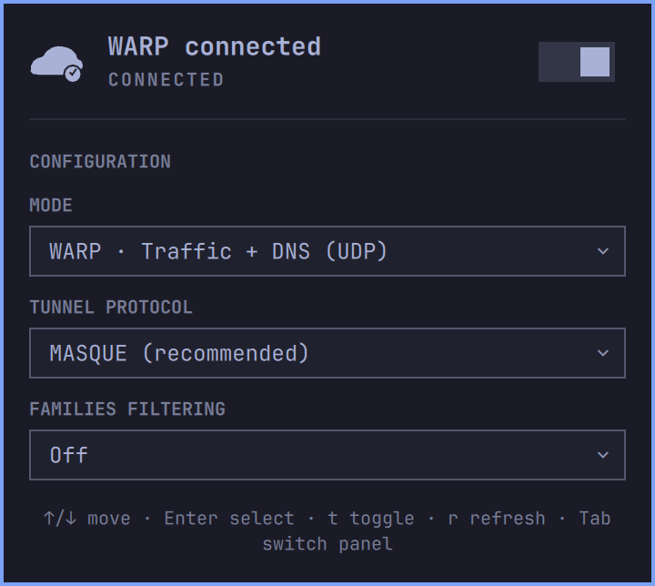

# Cloudflare WARP for Omarchy

This is an independent, unofficial Omarchy plugin for the Cloudflare® WARP® client. It is unaffiliated with and not endorsed, sponsored, or supported by Cloudflare, Inc. or Omarchy.

Cloudflare® and WARP® are trademarks and/or registered trademarks of Cloudflare, Inc. in the United States and other jurisdictions.

A theme-native Omarchy 4 Quattro bar panel for managing the local Cloudflare WARP client. It reports the client’s confirmed state, connects or disconnects WARP, and exposes a focused set of consumer connection and DNS settings. It is unrelated to the existing Cloudflare account plugin.



## Requirements and installation

Cloudflare does **not officially support Arch Linux**. Before enabling the plugin, install the community-maintained `cloudflare-warp-bin` AUR package at your own discretion:

```sh
omarchy pkg aur add cloudflare-warp-bin
```

The panel recognizes `/usr/bin/warp-cli` automatically. If the WARP service is stopped, its **Start WARP service** action asks for confirmation and then opens the system Polkit authentication dialog. You can also start it yourself:

```sh
sudo systemctl enable --now warp-svc.service
```

Install the plugin and place it in the right section after Omarchy’s network widget:

```sh
omarchy plugin add https://github.com/rui-pedro-silva/omarchy-cloudflare-warp --enable --yes
omarchy bar move io.github.rui-pedro-silva.cloudflare-warp --section right --after omarchy.network
```

### Test a local checkout

During development, link the checkout into the user plugin directory, enable it, and rescan:

```sh
ln -s "$PWD" ~/.config/omarchy/plugins/io.github.rui-pedro-silva.cloudflare-warp
omarchy plugin enable io.github.rui-pedro-silva.cloudflare-warp
omarchy bar move io.github.rui-pedro-silva.cloudflare-warp --section right --after omarchy.network
omarchy-shell shell rescanPlugins
```

Use the link command only when that destination does not already exist. Files under `~/.config/omarchy/plugins/` normally reload when saved; `omarchy restart shell` forces a clean restart if needed.

## Interaction

The popup uses Omarchy’s native keyboard panel, typography, spacing, borders, focus chrome, and current theme colors. It is a single scrollable panel so every control remains reachable with larger theme fonts.

The cloud’s lower-right badge reports status without relying on color: **✓** means confirmed connected, **−** means confirmed disconnected, a dot with a subtle pulse means checking or changing state, and **!** means attention is required. The connected badge appears only after `warp-cli` confirms the real state.

Mouse controls:

- Left-click opens or closes the panel.
- Right-click connects or disconnects WARP. If the action is unavailable, it opens the panel to explain why.
- Middle-click refreshes status and settings.

Keyboard controls:

- `↑`/`↓` or `j`/`k` moves the panel cursor.
- Enter or Space activates the selected switch or opens a selector.
- Inside a selector, `↑`/`↓` or `j`/`k` chooses an option; Enter confirms and Escape closes it.
- `t` connects or disconnects WARP, `r` refreshes, and Escape closes the panel.
- Tab and Shift-Tab switch to adjacent Omarchy panels.

The plugin polls the inexpensive status command every 15 seconds by default. It refreshes registration and settings on startup, panel open, manual refresh, and after a successful action. The widget setting `refreshIntervalSec` accepts 5–300 seconds.

## Supported controls

- Mode: WARP, DoH, WARP + DoH, DoT, WARP + DoT, Local proxy, or Traffic only.
- Tunnel protocol: MASQUE or WireGuard.
- Families filtering: Off, Malware, or Malware + adult content.

Local proxy requires MASQUE, so the panel cannot create a Local proxy + WireGuard combination. Local proxy only routes applications explicitly configured to use Cloudflare’s localhost proxy; selecting it does not route all system traffic, and this plugin intentionally does not edit the proxy port or application settings.

Tunnel protocol is stored but inactive in DNS-only modes. Families filtering is inactive in Local proxy and Traffic-only modes because DNS remains outside WARP; the panel says so instead of implying that filtering is active.

Current Linux 2026.6 output does not include a `Families mode:` row. The plugin instead parses the anchored `Resolve via:` setting and recognizes only Cloudflare’s documented public resolver hostnames:

- `cloudflare-dns.com` or `one.one.one.one` → Off
- `security.cloudflare-dns.com` → Malware
- `family.cloudflare-dns.com` → Malware + adult content

The default unmanaged client was verified live with `cloudflare-dns.com`, and parser fixtures cover every mapping above. Cloudflare publishes the same DoH/DoT mapping in its [1.1.1.1 available endpoints](https://developers.cloudflare.com/1.1.1.1/infrastructure/network-operators/#available-endpoints). A custom resolver, a malformed line, or any unfamiliar future hostname remains Unknown and keeps configuration disabled rather than guessing a Families state. Raw resolver values are never exposed through IPC.

Existing Zero Trust registrations remain visible and can perform connection actions permitted by policy. Their configuration is read-only. `Switch Locked` is reported separately: it prevents disconnecting but does not falsely label every managed registration as locked.

Organization enrollment, registration deletion, WARP+ keys, devices, trusted networks, split tunnels, proxy-port editing, and settings reset are outside v1.

## Registration and privileges

Consumer registration always requires an in-panel confirmation before accepting Cloudflare’s Terms of Service. Before first use, `warp-cli 2026.6` gates even its status and settings reads behind that acceptance, so the plugin cannot know the device’s MDM organization state in advance. Managed users should cancel the confirmation and follow their administrator’s enrollment instructions.

On Linux 2026.6, `--accept-tos` authorizes one non-interactive invocation; it does not make later CLI calls stop requesting acceptance. After the explicit confirmation, the panel stores only one consent datum—`termsAccepted: true`—in Omarchy’s native persisted settings for this bar entry. This boolean is not a credential and contains no account, device, license, organization, or registration data. The plugin then supplies the fixed global `--accept-tos` option to subsequent `warp-cli` reads and actions.

The first accepted operation is WARP’s dedicated JSON MDM-configuration query. The plugin creates a consumer registration only for the exact recognized unmanaged result: no active configuration and an empty available-configurations list. Active, available, unfamiliar, malformed, or failed MDM output blocks registration without asking you to use a terminal.

If WARP reports the exact existing-registration condition, the plugin performs an accepted read-only refresh and adopts the existing registration. It never responds by deleting that registration, and it does not reinterpret unrelated errors as success.

The plugin never edits Cloudflare state files and never constructs shell command strings. Its only privileged operation is the separately confirmed fixed argument array:

```text
pkexec systemctl enable --now warp-svc.service
```

## IPC

The IPC target is `io.github.rui-pedro-silva.cloudflare-warp`. It exposes `open`, `close`, `show`, `hide`, `toggle`, `refresh`, `connect`, `disconnect`, `toggleWarp`, and `status`.

`status` returns JSON containing only `state`, `connected`, `mode`, `protocol`, `families`, `managed`, `locked`, `busy`, and a categorical `error`. Values are normalized through fixed allowlists; raw CLI output, organization names, registration identifiers, hostnames, URLs, and tokens are never returned.

```sh
omarchy-shell io.github.rui-pedro-silva.cloudflare-warp status
```

## Complete command inventory

Ordinary WARP commands use this fixed array shape; brackets indicate the one conditional global option:

```text
env LC_ALL=C LANG=C NO_COLOR=1 TERM=dumb PAGER=cat warp-cli --no-ansi --no-paginate [--accept-tos] <subcommand>
```

The bracketed `--accept-tos` is absent before consent and present after the user’s explicit confirmation. Consumer registration always includes it. It is never derived from CLI output or other untrusted data.

The only ordinary subcommands and values the plugin can construct are:

```text
status
registration show
settings list
connect
disconnect
registration new
mode {warp|doh|warp+doh|dot|warp+dot|proxy|tunnel_only}
tunnel protocol set {MASQUE|WireGuard}
dns families {off|malware|full}
```

The confirmed registration safety check uses this separate fixed array so it can parse WARP’s machine-readable MDM result without retaining configuration values:

```text
env LC_ALL=C LANG=C NO_COLOR=1 TERM=dumb PAGER=cat warp-cli --json --no-ansi --no-paginate --accept-tos mdm get-configs
```

Together with the one `pkexec systemctl` command disclosed above, this is the complete subprocess inventory.

## Troubleshooting

- **Package required:** the panel clearly states that `cloudflare-warp-bin` must be installed first and recommends the community AUR package. It does not copy or execute an install command.
- **Package installed but still unavailable:** run `command -v warp-cli` and confirm it reports `/usr/bin/warp-cli`, then press `r` or run `omarchy restart shell` to reload the plugin process.
- **Service stopped:** choose **Start WARP service**, confirm, and authenticate in the system Polkit dialog. Canceling leaves the service unchanged.
- **Registration unavailable:** refresh and retry the in-panel action. An active or available MDM configuration requires administrator-managed enrollment; unfamiliar or failed MDM output remains blocked rather than risking enrollment into the wrong organization.
- **Registration already exists:** the plugin refreshes and adopts a recognized existing registration. It never runs or recommends registration deletion.
- **No network, DNS, or tunnel failure:** restore ordinary connectivity, refresh, then inspect `warp-cli status` in a terminal for the detailed diagnostic. IPC deliberately returns only a safe category.
- **Managed or Switch Locked:** ask the Zero Trust administrator; the plugin never bypasses policy.
- **Unknown status/settings:** the client output is newer or malformed. The plugin fails closed and never reports Connected or enables configuration from unrecognized output.

## Validation and removal

```sh
npm test
npm run validate
omarchy plugin validate .
OMARCHY_PATH=${OMARCHY_PATH:-/usr/share/omarchy}
qmllint -I "$OMARCHY_PATH/shell" Panel.qml PanelConfirmDialog.qml Service.qml CloudIcon.qml
```

Standalone `qmllint` is advisory: this host’s Qt parser rejects Quickshell’s typed `IpcHandler` method syntax even though the running Omarchy shell loads it successfully. The release checklist also requires live Malware and Malware + adult content actions, plus the full keyboard/mouse/IPC lifecycle.

Remove the panel with:

```sh
omarchy plugin remove io.github.rui-pedro-silva.cloudflare-warp --yes
```

Removing the plugin does **not** disconnect, unregister, disable, or uninstall Cloudflare WARP.

## Compatibility and privacy

Tested with Omarchy 4 Quattro and `warp-cli 2026.6.880.0`. Unknown output from later clients fails closed. Follow Cloudflare’s current [Linux CLI guide](https://developers.cloudflare.com/warp-client/get-started/linux/), [WARP modes documentation](https://developers.cloudflare.com/warp-client/warp-modes/), and the [Omarchy plugin contract](https://omarchyplugins.com/develop.html).

WARP can encrypt traffic between the device and Cloudflare, but Cloudflare explicitly cautions that it does not provide anonymity.

Licensed under MIT.
